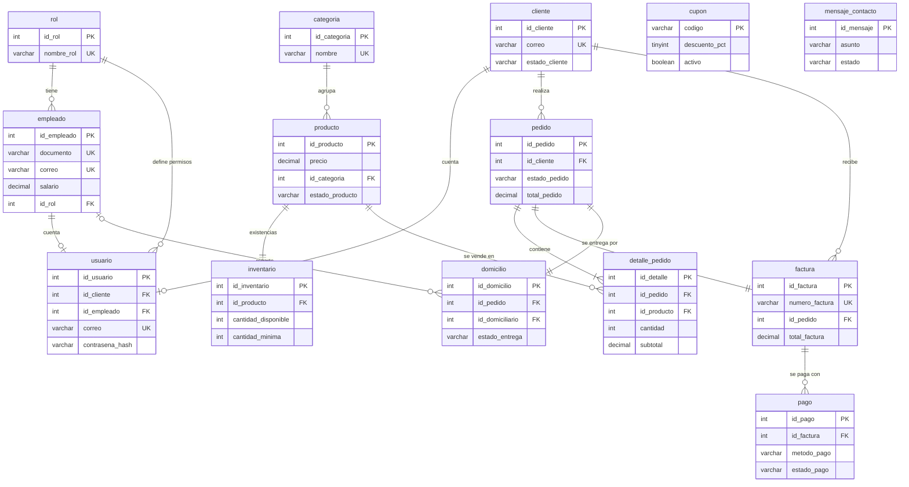

# Base de datos de FlanBross

Motor: **MySQL 8** (probado el SQL también en MariaDB 10.11). Acceso: **JDBC con SQL explícito**
(`Persistencia.jdbc`). Esquema versionado con **Flyway** (`src/main/resources/db`).

## Puesta en marcha

**Opción A — Docker (recomendada):** `docker compose up -d` y luego `.\mvnw.cmd spring-boot:run`.

**Opción B — MySQL instalado** (como administrador):

```sql
CREATE DATABASE flanbross CHARACTER SET utf8mb4 COLLATE utf8mb4_unicode_ci;
CREATE USER 'flanbross'@'localhost' IDENTIFIED BY 'flanbross';
GRANT ALL PRIVILEGES ON flanbross.* TO 'flanbross'@'localhost';
```

Otra base o credenciales: variables de entorno `DB_URL`, `DB_USUARIO`, `DB_CLAVE`.
Al arrancar, Flyway aplica en orden `V1__esquema.sql`, `V2__datos_base.sql` y `V100__datos_demo.sql`
y lo registra en la tabla `flyway_schema_history`. **No se edita una migración ya aplicada:** un
cambio nuevo es un archivo `V3__...sql`. En producción se quita `classpath:db/demo` de
`spring.flyway.locations` para no cargar datos de ejemplo.

## Modelo entidad-relación



Son 14 tablas. `cupon` y `mensaje_contacto` no se relacionan con otras.

## Decisiones de diseño (para el informe)

| Decisión | Motivo |
|---|---|
| `inventario` es la única fuente del stock; se eliminó `producto.stock` | El stock estaba duplicado en dos modelos. Ahora hay un solo dato que mantener. |
| Tabla `categoria` (antes un texto repetido en cada producto) | Normalización (3FN): una categoría se renombra en un solo lugar. |
| `usuario` apunta a un cliente **o** a un empleado (`CHECK`) | Una cuenta no puede quedar sin titular ni con dos. |
| Contraseñas con **BCrypt**; token de recuperación guardado como **SHA-256** | Nada reutilizable queda en texto plano en la base. |
| Descuento de stock atómico: `UPDATE … WHERE cantidad_disponible >= ?` | Dos compras simultáneas no dejan stock negativo; además hay `CHECK (cantidad_disponible >= 0)`. |
| Crear pedido, factura, pago y domicilio en **una transacción** | Si algo falla (p. ej. falta stock en la 3.ª línea) no queda nada a medias. |
| Estados con `CHECK` (pedido, pago, factura, domicilio…) | La base rechaza valores inválidos aunque falle la validación de la aplicación. |
| `CHECK` aritméticos: `subtotal = precio × cantidad`, `total = subtotal + impuestos` | Los montos no pueden quedar incoherentes. |
| Dinero en `DECIMAL(12,0)` | El peso colombiano no maneja centavos; evita errores de coma flotante. |
| `estado_inventario` (normal/bajo/crítico) se calcula, no se guarda | Un dato derivado guardado puede desactualizarse. |
| JDBC + SQL en vez de JPA | SQL visible y defendible en la sustentación; control exacto de transacciones. Las interfaces `Persistencia.*` permitirían cambiarlo a JPA sin tocar controladores. |

## Datos de demostración

Los totales de pedidos, facturas y pagos se **recalcularon** desde las líneas de cada pedido: el
JSON original tenía desajustes (por ejemplo, el pedido 3 sumaba $85.000 en sus líneas pero decía
$90.000, y las facturas no aplicaban el IVA del 8 % que sí aplica el código). Por eso las cifras del
panel de demostración ya no coinciden con las del JSON.

## Verificación realizada

El SQL de las tres migraciones se ejecutó en MariaDB 10.11: carga sin errores, las restricciones
rechazan estados inválidos, cuentas sin titular, montos incoherentes, correos duplicados (sin
distinguir mayúsculas), stock negativo y claves foráneas inexistentes; y una transacción de pedido
confirma al tener stock y se revierte completa si no lo hay.
